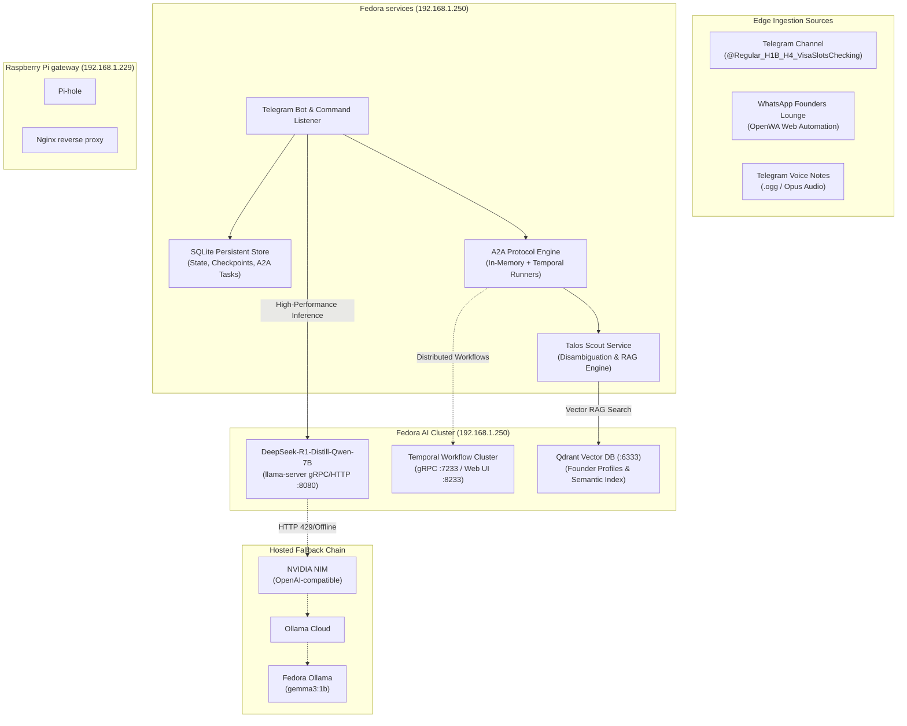

# Appointment Notifier & Talos Agent Node

Autonomous edge monitoring agent and **Talos Protocol Agent-to-Agent (A2A)** node.
Watches `@Regular_H1B_H4_VisaSlotsChecking` on Telegram, monitors the WhatsApp Founders Lounge, performs RAG prospect scoring with Qdrant, serves A2A protocol endpoints, and notifies you across Telegram, WhatsApp, SMS, email, and iMessage.

---

## Architecture Overview



---

## Key Capabilities

1. **Autonomous Visa Monitoring**:
   - Real-time Telegram channel monitoring with startup backlog replay.
   - Deterministic slot parsing (H1B/H4 Dropbox, consular, biometrics, bulk release detection).
   - Tesseract OCR layout parsing with SHA-256 media caching for screenshot-based availability claims.
   - Clean, direct conversational answers without raw telemetry or task header spam.
2. **Talos Protocol & Founder Scout**:
   - Real-time WhatsApp Founders Lounge community monitor (`WhatsAppWatcher`).
   - Strategic founder prospect analysis, capability matching, and B2B partnership recommendations (`/talos`).
   - Qdrant vector database semantic search over founder profiles and startup offerings.
3. **Agent-to-Agent (A2A) v1 Standard**:
   - Compliant W3C Agent Card discovery at `/.well-known/agent.json`.
   - JSON-RPC 2.0 task execution API at `/rpc` (`tasks/send`, `tasks/get`, `tasks/cancel`, `tasks/list`).
   - Real-time streaming task execution with live progress reporting on Telegram.
   - Pluggable runners: `InMemoryTaskRunner` for edge sub-second responsiveness, `TemporalTaskRunner` for durable multi-step workflows.
4. **Resilient Multi-Tier LLM Offload**:
   - Primary: High-speed local GPU inference via `DeepSeek-R1-Distill-Qwen-7B` on Fedora (`192.168.1.250:8080`).
   - Automatic reasoning-trace (`<think>`) extraction for clean user answers.
   - Graceful fallback chain: NVIDIA NIM → Ollama Cloud → Fedora Ollama (`gemma3:1b`).
5. **Multi-Channel Alerting**:
   - Telegram Bot, WhatsApp (OpenWA v5 alpha self-hosted or Twilio), SMS (Twilio), SMTP email, and macOS iMessage.

---

## Setup & Quickstart

```bash
python3 -m venv .venv
source .venv/bin/activate
pip install -e ".[sms,dev]"
cp .env.example .env
```

Fill in `.env`, then run:

```bash
set -a
source .env
set +a
appointment-notifier run
```

---

## CLI Commands

```bash
# Core execution
appointment-notifier run                     # Start Telegram & WhatsApp watchers, A2A engine, bot
appointment-notifier test-notify             # Send test alerts across all enabled notification channels

# Telemetry & analysis
appointment-notifier parse-text "H1B Dropbox slots available in Chennai"
appointment-notifier trend                   # Display statistical release cadence & historical window
appointment-notifier trend --no-llm          # Output pure deterministic metrics without LLM summary
appointment-notifier ask "When are appointments usually posted?"
appointment-notifier backfill --chat @Regular_H1B_H4_VisaSlotsChecking --limit 5000
```

---

## Telegram Bot Commands

The visa bot is `@usvisaavaibalitynotifierinbot`; `@talosprotocolaibot` handles Talos and A2A requests. Their tokens, polling processes, and SQLite state are separate. The configured visa username is spelled exactly as shown here; similarly spelled Telegram handles are different accounts.

| Bot | Commands | Purpose |
|---|---|---|
| Visa | `/ask`, `/current`, `/last`, `/trend`, `/status` | Appointment questions and observed slot history. |
| Talos | `/talos`, `/scout`, `/startups`, `/task`, `/campaign`, `/a2a` | Startup analysis and A2A tasks. |
| Both | `/help`, `/whoami`, `/forget`, `/users`, `/allow`, `/revoke` | Help and access management. |

Voice notes route through the Talos bot. The visa bot directs Talos and voice requests to `@talosprotocolaibot`.

After the October 22 Pi outage, the visa notifier container and the separate
Talos bot run on Fedora. The Pi runs Pi-hole and Nginx for the app routes. See
[the migration runbook](management/telegram-failover.md) for service placement,
verification, and the remaining WhatsApp session issue.

---

## Agent-to-Agent (A2A) v1 Specification

The node exposes native A2A v1 protocol endpoints:

### 1. Agent Discovery Card
```http
GET /.well-known/agent.json
```
Returns:
```json
{
  "name": "Visa & Talos Multi-Agent Node",
  "description": "Autonomous visa monitoring and Talos Protocol founder intelligence agent",
  "version": "1.0.0",
  "endpoints": {
    "rpc": "/rpc"
  },
  "capabilities": {
    "streaming": true,
    "multimodal": ["text", "audio"]
  },
  "skills": [
    {"id": "visa_availability", "name": "Visa Slot Monitor"},
    {"id": "talos_scout", "name": "Talos Startup Scout"}
  ]
}
```

### 2. JSON-RPC 2.0 Execution
```http
POST /rpc
Content-Type: application/json

{
  "jsonrpc": "2.0",
  "method": "tasks/send",
  "params": {
    "message": {
      "role": "user",
      "parts": [{"text": "When was the last visa available?"}]
    }
  },
  "id": "req-01"
}
```

---

## Inference Configuration (Fedora & Fallbacks)

The LLM client dynamically resolves inference endpoints in priority order:

1. **Fedora Remote Server (`fedora`):**
   - Address: `http://192.168.1.250:8080`
   - Model: `DeepSeek-R1-Distill-Qwen-7B`
   - High speed GPU offload, zero token costs, local network security.
2. **NVIDIA NIM (`nvidia`):**
   - Configured via `.secrets/nvidia_api_key`.
   - Hosted high-throughput fallback.
3. **Ollama Cloud (`ollama_cloud`):**
   - Configured via `.secrets/ollama_api_key`.
4. **Fedora Ollama (`ollama`):**
   - Local `gemma3:1b` model running in Docker on Fedora (`http://192.168.1.250:11434`). The Pi's old `:11434` address proxies to Fedora.

---

## Notification Notes

Telegram bot alerts use `TELEGRAM_ALERT_ENABLED=true`, `TELEGRAM_BOT_TOKEN`, and `TELEGRAM_ALERT_CHAT_ID`.

Email uses SMTP. Gmail generally requires an app password, not your normal account password.

SMS uses Twilio when `SMS_ENABLED=true` and Twilio credentials are present.

WhatsApp uses self-hosted OpenWA or Twilio. Set `WHATSAPP_PROVIDER=openwa` or
`WHATSAPP_PROVIDER=twilio` explicitly for the desired provider.

iMessage uses macOS AppleScript through the local Messages app. macOS may prompt for Automation permissions.

## WhatsApp Alert Setup with OpenWA

OpenWA is built from the pinned `nileshchakraborty/wa-automate-nodejs` fork
commit `975a32d4eed560f784a079e2466a0ece9cfad008` and runs in Docker on Fedora.
The deployment files are in `management/openwa-fedora`; Fedora's runtime
directory is `/home/nilesh/openwa-service`. OpenWA is unofficial WhatsApp Web
automation; use a dedicated account.

Generate an API key and add these values to `.env`:

```bash
WHATSAPP_ENABLED=true
WHATSAPP_PROVIDER=openwa
WHATSAPP_TO=whatsapp:+15551234567
OPENWA_URL=http://192.168.1.250:8081
OPENWA_API_KEY=replace-with-a-long-random-value
```

Copy `management/openwa-fedora/` to `/home/nilesh/openwa-service` on Fedora,
create `/home/nilesh/openwa-service/.env` with a protected `WA_API_KEY` entry,
then build and start OpenWA:

```bash
cd /home/nilesh/openwa-service
umask 077
printf 'WA_API_KEY=%s\n' "$(openssl rand -hex 32)" > .env
docker compose -f compose.yml up -d --build
```

Open `http://192.168.1.229:8081/dashboard/` through the Pi Nginx proxy and scan
the QR code from WhatsApp's Linked Devices screen if the session is unconnected.
The encrypted session file is persisted in
`/home/nilesh/openwa-service/chrome-profile/default.data.json`. Check `/health`
for `connected: true` and `session.ready: true`; HTTP 200 alone is insufficient.

After OpenWA reports that it is connected, send a test from Fedora:

```bash
cd /home/nilesh/appointment-notifier
docker compose -f docker-compose.fedora.yml exec appointment-notifier appointment-notifier test-notify
```

To use Twilio instead, set `WHATSAPP_PROVIDER=twilio` and configure `TWILIO_ACCOUNT_SID`, `TWILIO_AUTH_TOKEN`, `WHATSAPP_FROM`, and `WHATSAPP_TO` as before.

## Fedora notifier service

The visa notifier runs on Fedora with Docker Compose:

```bash
cd /home/nilesh/appointment-notifier
docker compose -f docker-compose.fedora.yml up -d --build
docker compose -f docker-compose.fedora.yml logs -f appointment-notifier
```

The container reads `.env` from the Fedora project directory and mounts `.state`
so the copied Telegram session and SQLite state survive container rebuilds.

### Queued Telegram alerts

The Fedora Compose stack runs a persistent, internal Kafka broker and three
Telegram delivery workers. A matching source post writes one SQLite outbox job
per configured or allowed recipient before it is marked as handled. The watcher
publishes job IDs to Kafka; workers send through the visa bot and mark each job
delivered separately. Transient failures retry with a 2–60 second delay.
Telegram HTTP 400/403 responses are kept as terminal failures in the outbox.
The broker is not exposed on a host port and stores job IDs only; the alert text
remains in the existing protected SQLite state directory.

The first startup replays the latest 100 source posts. After that, the watcher
stores its processed source ID and catches up all later posts after a restart.
Alerts sent more than five minutes after
their source timestamp are labeled as delayed because availability may have
changed. Kafka and the SQLite outbox are persistent, but this is a single-host
deployment. Telegram API outages and host failures can delay delivery, and an
unacknowledged API response can cause a duplicate. Measure live latency from
the `Telegram job ... delivered in ...ms from enqueue` log line; no fixed latency
is guaranteed during outages.

Useful checks on Fedora:

```bash
docker compose -f docker-compose.fedora.yml ps
docker compose -f docker-compose.fedora.yml logs --since 10m appointment-notifier telegram-delivery kafka
docker compose -f docker-compose.fedora.yml exec appointment-notifier python -c 'from appointment_notifier.store import AlertStore; from appointment_notifier.config import load_settings; s=AlertStore(load_settings(False).sqlite_path, initialize=False); print(s.telegram_job_counts()); s.close()'
```

Rollback: change the watcher's `TELEGRAM_QUEUE_ENABLED` value to `"false"` in
`docker-compose.fedora.yml`, restore its prior startup replay setting, and
recreate only the watcher. Keep the Kafka volume and
SQLite outbox until all pending jobs have been reviewed; removing them discards
undelivered alerts. A direct-send rollback does not process already queued jobs.

If using the older host-level systemd service:

```bash
sudo systemctl status appointment-notifier.service
sudo journalctl -u appointment-notifier.service -f
sudo systemctl restart appointment-notifier.service
sudo systemctl stop appointment-notifier.service
```

On Linux, keep `IMESSAGE_ENABLED=false`; iMessage delivery requires macOS Messages.

## Telegram Bot Alert Setup

1. Open Telegram and message `@BotFather`.
2. Send `/newbot`, choose a display name, then choose a bot username ending in `bot`.
3. Copy the token BotFather gives you into `.env` as `TELEGRAM_BOT_TOKEN`.
4. Open a chat with your new bot and send it any message, such as `start`.
5. Get your chat id:

```bash
curl "https://api.telegram.org/bot$TELEGRAM_BOT_TOKEN/getUpdates"
```

Look for `message.chat.id` in the JSON response. Put that value in `.env`:

```bash
TELEGRAM_ALERT_ENABLED=true
TELEGRAM_BOT_TOKEN=123456:replace-with-real-token
TELEGRAM_ALERT_CHAT_ID=123456789
# Optional bootstrap users. Owners can manage users from Telegram commands.
TELEGRAM_BOT_ALLOWED_USERNAMES=friend_username
TELEGRAM_BOT_OWNER_CHAT_ID=123456789
```

Then test:

```bash
set -a
source .env
set +a
appointment-notifier test-notify
```

The same bot stores allowed command users in SQLite. On startup it seeds that table from `TELEGRAM_ALERT_CHAT_ID`, `TELEGRAM_BOT_ALLOWED_USERNAMES`, `TELEGRAM_BOT_OWNER_CHAT_ID`, and `TELEGRAM_BOT_OWNER_USERNAMES`, so keep your own numeric chat id in `TELEGRAM_BOT_OWNER_CHAT_ID` as a recovery path.

```text
/current
/last
/trend
/ask When are slots most often reported?
/forget
/status
/whoami
/users
/allow <chat_id|@username> [owner]
/revoke <chat_id|@username>
/help
```

`/current` returns the current boolean availability state. `/last` returns the last known availability timestamp/source. Authorized users can send normal text or use `/ask` to chat with the local model. `/forget` deletes that Telegram chat's bounded conversation history. `/users`, `/allow`, and `/revoke` are owner-only. `/revoke` will not remove owner rows.

Users added by `/allow @username` must first send `/start` to the bot in a
private chat. Telegram does not provide a private chat ID from a username
alone. Once they message the bot, their chat ID is saved and matching visa
alerts are sent to them under the existing source-message rules. Explicit
`TELEGRAM_ALERT_CHAT_ID` recipients also continue to receive alerts.

## Historical Trend Forecast

Every observed Telegram message is retained in SQLite with its parser result.
`appointment-notifier trend` clusters matching posts into likely release events,
reports posting frequency and reports-per-event, and calculates a conservative
next window from historical gaps. These are community report counts, not the
number of bookable consular appointments.

The optional LLM integration explains deterministic statistics and provides
bounded Telegram chat. It does not generate or replace the statistical
forecast. Providers are attempted in `LLM_PROVIDER_ORDER`; failures, HTTP 429
responses, and unavailable providers move to the next configured provider.
Every response names the provider that answered. If all providers fail,
`/trend` still returns the deterministic report and chat fails closed with a
short retry message.

### Historical backfill

Run the resumable importer before relying on long-range forecasts:

```bash
appointment-notifier backfill --chat @Regular_H1B_H4_VisaSlotsChecking --limit 5000
```

Use `--all-chats` to inventory accessible Telegram groups/channels, or repeat
`--chat` for an explicit allowlist. The importer stores canonical messages,
OCR/layout results, parser classifications, checkpoints, and a materialized
trend snapshot in SQLite. It does not call the LLM. Re-running resumes from
the per-chat checkpoint and reuses cached OCR by media hash.

The supported providers are:

- `nvidia`: NVIDIA-hosted NIM using its OpenAI-compatible chat endpoint.
- `ollama_cloud`: direct authenticated access to Ollama Cloud.
- `ollama`: a local or remote Ollama server; the current service runs on Fedora.

Cloud API keys are read only from files mounted under `/run/secrets`; never put
them in `.env`. Create the host directory before starting Compose:

```bash
install -d -m 700 .secrets
```

The default secret filenames are `.secrets/nvidia_api_key` and
`.secrets/ollama_api_key`. Enable a provider only after its secret is present.
To enter or rotate either key without echoing it or placing it in shell history,
run `management/configure-llm-secrets.sh` on Fedora. Leaving a prompt blank
preserves the existing value.
For the NVIDIA-first chain:

```bash
LLM_PROVIDER_ORDER=nvidia,ollama_cloud,ollama
NVIDIA_NIM_ENABLED=true
NVIDIA_NIM_MODEL=openai/gpt-oss-20b
NVIDIA_NIM_TIMEOUT_SECONDS=90
OLLAMA_CLOUD_ENABLED=true
OLLAMA_ENABLED=true
```

The NVIDIA timeout is intentionally shorter than the other provider timeouts
so a stalled hosted deployment quickly yields to the configured fallbacks.

The lightweight `gemma3:1b` Ollama model runs on Fedora as the final fallback.
The model directory was copied from the Pi and verified by file hashes. Start it
on Fedora with:

```bash
cd /home/nilesh/ollama-deploy
docker compose up -d
```

The Compose file is `management/docker-compose.fedora-ollama.yml`. The notifier
uses `OLLAMA_URL=http://192.168.1.250:11434`. The Pi native `ollama.service` is
disabled; Nginx preserves the old LAN address at `192.168.1.229:11434`.

## Future US Visa Scheduling Integration

Direct integration with `usvisascheduling.com` should be treated as high-risk automation. The safe next phase is:

- Keep Telegram monitoring as the primary low-risk signal.
- Use any official notifications or user-initiated checks first.
- If browser assistance is added, make it user-controlled, rate-limited, and auditable.
- Do not add CAPTCHA bypass, fingerprint spoofing, proxy rotation, or bot-detection evasion.
- Use long cool-downs after login failures or warning pages, because aggressive lookup behavior can lead to temporary blocks.
