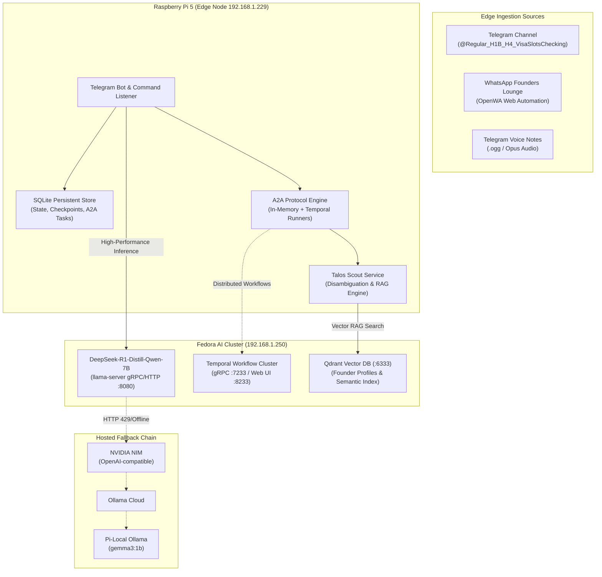

# Appointment Notifier & Talos Agent Node

Autonomous edge monitoring agent and **Talos Protocol Agent-to-Agent (A2A)** node.
Watches `@Regular_H1B_H4_VisaSlotsChecking` on Telegram, monitors the WhatsApp Founders Lounge, performs RAG prospect scoring with Qdrant, serves A2A protocol endpoints, and notifies you across Telegram, WhatsApp, SMS, email, and iMessage.

---

## Architecture Overview



---

## Key Capabilities

1. **Autonomous Visa Monitoring**:
   - Real-time Telegram channel monitoring with startup backlog replay.
   - Deterministic slot parsing (H1B/H4 Dropbox, consular, biometrics, bulk release detection).
   - Tesseract OCR layout parsing with SHA-256 media caching for screenshot-based availability claims.
   - Clean, direct conversational answers without raw telemetry or task header spam.
2. **Talos Protocol & Founder Scout**:
   - Real-time WhatsApp Founders Lounge community monitor (`WhatsAppWatcher`).
   - Strategic founder prospect analysis, capability matching, and B2B partnership recommendations (`/talos`).
   - Qdrant vector database semantic search over founder profiles and startup offerings.
3. **Agent-to-Agent (A2A) v1 Standard**:
   - Compliant W3C Agent Card discovery at `/.well-known/agent.json`.
   - JSON-RPC 2.0 task execution API at `/rpc` (`tasks/send`, `tasks/get`, `tasks/cancel`, `tasks/list`).
   - Real-time streaming task execution with live progress reporting on Telegram.
   - Pluggable runners: `InMemoryTaskRunner` for edge sub-second responsiveness, `TemporalTaskRunner` for durable multi-step workflows.
4. **Resilient Multi-Tier LLM Offload**:
   - Primary: High-speed local GPU inference via `DeepSeek-R1-Distill-Qwen-7B` on Fedora (`192.168.1.250:8080`).
   - Automatic reasoning-trace (`<think>`) extraction for clean user answers.
   - Graceful fallback chain: NVIDIA NIM → Ollama Cloud → Pi-local Ollama (`gemma3:1b`).
5. **Multi-Channel Alerting**:
   - Telegram Bot, WhatsApp (OpenWA v5 alpha self-hosted or Twilio), SMS (Twilio), SMTP email, and macOS iMessage.

---

## Setup & Quickstart

```bash
python3 -m venv .venv
source .venv/bin/activate
pip install -e ".[sms,dev]"
cp .env.example .env
```

Fill in `.env`, then run:

```bash
set -a
source .env
set +a
appointment-notifier run
```

---

## CLI Commands

```bash
# Core execution
appointment-notifier run                     # Start Telegram & WhatsApp watchers, A2A engine, bot
appointment-notifier test-notify             # Send test alerts across all enabled notification channels

# Telemetry & analysis
appointment-notifier parse-text "H1B Dropbox slots available in Chennai"
appointment-notifier trend                   # Display statistical release cadence & historical window
appointment-notifier trend --no-llm          # Output pure deterministic metrics without LLM summary
appointment-notifier ask "When are appointments usually posted?"
appointment-notifier backfill --chat @Regular_H1B_H4_VisaSlotsChecking --limit 5000
```

---

## Telegram Bot Commands

| Command | Role | Description |
|---|---|---|
| `/ask <question>` | All Users | Ask a visa appointment question; replies with direct conversational response. |
| `/talos <question>` | All Users | Query Talos Scout for startup analysis, partnership matches, and founder outreach. |
| `/current` | All Users | Check current boolean slot availability state. |
| `/last` | All Users | Display last observed slot observation and timestamp. |
| `/trend` | All Users | View full statistical trend report and release cadence forecast. |
| `/task list` | All Users | List recent A2A autonomous tasks and current states. |
| `/task get <id>` | All Users | Inspect detailed status and messages for an A2A task. |
| `/task cancel <id>` | All Users | Cancel an in-progress A2A task. |
| `/campaign <name>` | Owner | Dispatch a distributed Temporal swarm campaign across agent workers. |
| `/status` | All Users | Check health of local services, Fedora LLM, Qdrant, and A2A engine. |
| `/whoami` | All Users | View your numeric chat ID, username, and role. |
| `/forget` | All Users | Clear conversational history for the current chat session. |
| `/users` | Owner | List authorized command users and owners. |
| `/allow <id\|@user> [owner]` | Owner | Authorize a new user or owner. |
| `/revoke <id\|@user>` | Owner | Revoke an authorized user. |
| `/help [visa\|talos]` | All Users | Show help documentation for visa or Talos commands. |

*Voice Notes:* Sending an audio voice note to the bot automatically transcribes the audio, runs A2A streaming task processing, and edits the message in place with the final answer.

---

## Agent-to-Agent (A2A) v1 Specification

The node exposes native A2A v1 protocol endpoints:

### 1. Agent Discovery Card
```http
GET /.well-known/agent.json
```
Returns:
```json
{
  "name": "Visa & Talos Multi-Agent Node",
  "description": "Autonomous visa monitoring and Talos Protocol founder intelligence agent",
  "version": "1.0.0",
  "endpoints": {
    "rpc": "/rpc"
  },
  "capabilities": {
    "streaming": true,
    "multimodal": ["text", "audio"]
  },
  "skills": [
    {"id": "visa_availability", "name": "Visa Slot Monitor"},
    {"id": "talos_scout", "name": "Talos Startup Scout"}
  ]
}
```

### 2. JSON-RPC 2.0 Execution
```http
POST /rpc
Content-Type: application/json

{
  "jsonrpc": "2.0",
  "method": "tasks/send",
  "params": {
    "message": {
      "role": "user",
      "parts": [{"text": "When was the last visa available?"}]
    }
  },
  "id": "req-01"
}
```

---

## Inference Configuration (Fedora & Fallbacks)

The LLM client dynamically resolves inference endpoints in priority order:

1. **Fedora Remote Server (`fedora`):**
   - Address: `http://192.168.1.250:8080`
   - Model: `DeepSeek-R1-Distill-Qwen-7B`
   - High speed GPU offload, zero token costs, local network security.
2. **NVIDIA NIM (`nvidia`):**
   - Configured via `.secrets/nvidia_api_key`.
   - Hosted high-throughput fallback.
3. **Ollama Cloud (`ollama_cloud`):**
   - Configured via `.secrets/ollama_api_key`.
4. **Pi Local Ollama (`ollama`):**
   - Local `gemma3:1b` model running as a native systemd service on the Pi (`http://192.168.1.229:11434`).

---

## Notification Notes

Telegram bot alerts use `TELEGRAM_ALERT_ENABLED=true`, `TELEGRAM_BOT_TOKEN`, and `TELEGRAM_ALERT_CHAT_ID`.

Email uses SMTP. Gmail generally requires an app password, not your normal account password.

SMS uses Twilio when `SMS_ENABLED=true` and Twilio credentials are present.

WhatsApp uses self-hosted OpenWA or Twilio. Set `WHATSAPP_PROVIDER=openwa` (the Raspberry Pi default) or `WHATSAPP_PROVIDER=twilio`.

iMessage uses macOS AppleScript through the local Messages app. macOS may prompt for Automation permissions.

## WhatsApp Alert Setup with OpenWA

The Raspberry Pi runs the pinned OpenWA fork in Docker with native ARM64 Chromium. OpenWA v4.76.0 no longer completes authentication against the current WhatsApp Web page, so this deployment intentionally uses the newer v5 alpha. OpenWA is unofficial WhatsApp Web automation; using it may violate WhatsApp's terms and can put the linked account at risk. Prefer a dedicated account.

Generate an API key and add these values to `.env`:

```bash
WHATSAPP_ENABLED=true
WHATSAPP_PROVIDER=openwa
WHATSAPP_TO=whatsapp:+15551234567
OPENWA_URL=http://openwa:8081
OPENWA_API_KEY=replace-with-a-long-random-value
```

The Compose build context expects the pinned fork at `openwa-fork`. Build and start both services:

```bash
git -C openwa-fork fetch origin master
git -C openwa-fork switch --detach fa63b0fca5367306bdf3fefe7efd9a6e299fc424
docker compose up -d --build
```

Open `http://192.168.1.229:8081/dashboard/` (or use `rpi.local` if mDNS works on your network), enter the OpenWA API key, and scan the QR code from WhatsApp's Linked Devices screen. Port 8081 is published only on the Pi's LAN address. The session is persisted under `openwa/sessions`.

After OpenWA reports that it is connected, send a test from the Pi:

```bash
docker compose exec appointment-notifier appointment-notifier test-notify
```

To use Twilio instead, set `WHATSAPP_PROVIDER=twilio` and configure `TWILIO_ACCOUNT_SID`, `TWILIO_AUTH_TOKEN`, `WHATSAPP_FROM`, and `WHATSAPP_TO` as before.

## Raspberry Pi Service

This app can run continuously on a Raspberry Pi with Docker Compose:

```bash
docker compose up -d --build
docker compose logs -f appointment-notifier
docker compose restart appointment-notifier
docker compose down
```

The container reads `.env` from the project directory and mounts `.state` so the Telegram session and SQLite state survive container rebuilds.

If using the older host-level systemd service:

```bash
sudo systemctl status appointment-notifier.service
sudo journalctl -u appointment-notifier.service -f
sudo systemctl restart appointment-notifier.service
sudo systemctl stop appointment-notifier.service
```

On Linux, keep `IMESSAGE_ENABLED=false`; iMessage delivery requires macOS Messages.

## Telegram Bot Alert Setup

1. Open Telegram and message `@BotFather`.
2. Send `/newbot`, choose a display name, then choose a bot username ending in `bot`.
3. Copy the token BotFather gives you into `.env` as `TELEGRAM_BOT_TOKEN`.
4. Open a chat with your new bot and send it any message, such as `start`.
5. Get your chat id:

```bash
curl "https://api.telegram.org/bot$TELEGRAM_BOT_TOKEN/getUpdates"
```

Look for `message.chat.id` in the JSON response. Put that value in `.env`:

```bash
TELEGRAM_ALERT_ENABLED=true
TELEGRAM_BOT_TOKEN=123456:replace-with-real-token
TELEGRAM_ALERT_CHAT_ID=123456789
# Optional bootstrap users. Owners can manage users from Telegram commands.
TELEGRAM_BOT_ALLOWED_USERNAMES=friend_username
TELEGRAM_BOT_OWNER_CHAT_ID=123456789
```

Then test:

```bash
set -a
source .env
set +a
appointment-notifier test-notify
```

The same bot stores allowed command users in SQLite. On startup it seeds that table from `TELEGRAM_ALERT_CHAT_ID`, `TELEGRAM_BOT_ALLOWED_USERNAMES`, `TELEGRAM_BOT_OWNER_CHAT_ID`, and `TELEGRAM_BOT_OWNER_USERNAMES`, so keep your own numeric chat id in `TELEGRAM_BOT_OWNER_CHAT_ID` as a recovery path.

```text
/current
/last
/trend
/ask When are slots most often reported?
/forget
/status
/whoami
/users
/allow <chat_id|@username> [owner]
/revoke <chat_id|@username>
/help
```

`/current` returns the current boolean availability state. `/last` returns the last known availability timestamp/source. Authorized users can send normal text or use `/ask` to chat with the local model. `/forget` deletes that Telegram chat's bounded conversation history. `/users`, `/allow`, and `/revoke` are owner-only. `/revoke` will not remove owner rows.

## Historical Trend Forecast

Every observed Telegram message is retained in SQLite with its parser result.
`appointment-notifier trend` clusters matching posts into likely release events,
reports posting frequency and reports-per-event, and calculates a conservative
next window from historical gaps. These are community report counts, not the
number of bookable consular appointments.

The optional LLM integration explains deterministic statistics and provides
bounded Telegram chat. It does not generate or replace the statistical
forecast. Providers are attempted in `LLM_PROVIDER_ORDER`; failures, HTTP 429
responses, and unavailable providers move to the next configured provider.
Every response names the provider that answered. If all providers fail,
`/trend` still returns the deterministic report and chat fails closed with a
short retry message.

### Historical backfill

Run the resumable importer before relying on long-range forecasts:

```bash
appointment-notifier backfill --chat @Regular_H1B_H4_VisaSlotsChecking --limit 5000
```

Use `--all-chats` to inventory accessible Telegram groups/channels, or repeat
`--chat` for an explicit allowlist. The importer stores canonical messages,
OCR/layout results, parser classifications, checkpoints, and a materialized
trend snapshot in SQLite. It does not call the LLM. Re-running resumes from
the per-chat checkpoint and reuses cached OCR by media hash.

The supported providers are:

- `nvidia`: NVIDIA-hosted NIM using its OpenAI-compatible chat endpoint.
- `ollama_cloud`: direct authenticated access to Ollama Cloud.
- `ollama`: a local or remote Ollama server, including the Pi or a laptop.

Cloud API keys are read only from files mounted under `/run/secrets`; never put
them in `.env`. Create the host directory before starting Compose:

```bash
install -d -m 700 .secrets
```

The default secret filenames are `.secrets/nvidia_api_key` and
`.secrets/ollama_api_key`. Enable a provider only after its secret is present.
To enter or rotate either key without echoing it or placing it in shell history,
run `management/configure-llm-secrets.sh` on the Pi. Leaving a prompt blank
preserves the existing value.
For the NVIDIA-first chain:

```bash
LLM_PROVIDER_ORDER=nvidia,ollama_cloud,ollama
NVIDIA_NIM_ENABLED=true
NVIDIA_NIM_MODEL=openai/gpt-oss-20b
NVIDIA_NIM_TIMEOUT_SECONDS=90
OLLAMA_CLOUD_ENABLED=true
OLLAMA_ENABLED=true
```

The NVIDIA timeout is intentionally shorter than the other provider timeouts
so a stalled hosted deployment quickly yields to the configured fallbacks.

The lightweight `gemma3:1b` local Ollama model remains available as the final
fallback. `OLLAMA_URL` can point to any remote Ollama server, so moving local
inference off the Pi does not require a code change.

On the Raspberry Pi, run Ollama as a native systemd service so model memory is
not duplicated inside Docker. Install
`management/ollama.service.override.conf` as
`/etc/systemd/system/ollama.service.d/appointment-notifier.conf`, then run:

```bash
sudo systemctl daemon-reload
sudo systemctl enable --now ollama
ollama pull gemma3:1b
```

The override binds Ollama only to the Pi's LAN address, limits it to one loaded
model and one parallel request, and disables cloud model fallback. The Docker
container should use `OLLAMA_URL=http://192.168.1.229:11434`. Keep port 11434
limited to the trusted LAN.

## Future US Visa Scheduling Integration

Direct integration with `usvisascheduling.com` should be treated as high-risk automation. The safe next phase is:

- Keep Telegram monitoring as the primary low-risk signal.
- Use any official notifications or user-initiated checks first.
- If browser assistance is added, make it user-controlled, rate-limited, and auditable.
- Do not add CAPTCHA bypass, fingerprint spoofing, proxy rotation, or bot-detection evasion.
- Use long cool-downs after login failures or warning pages, because aggressive lookup behavior can lead to temporary blocks.
