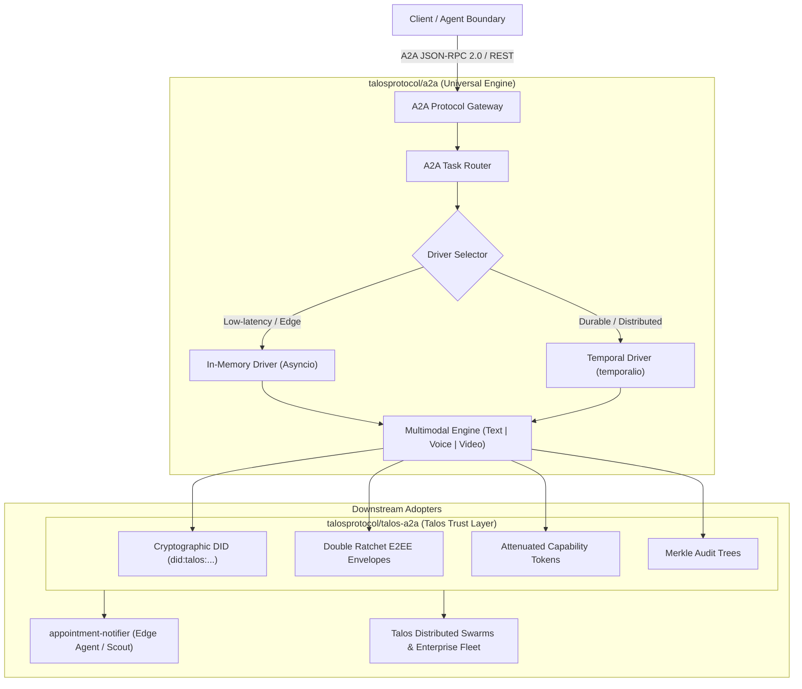
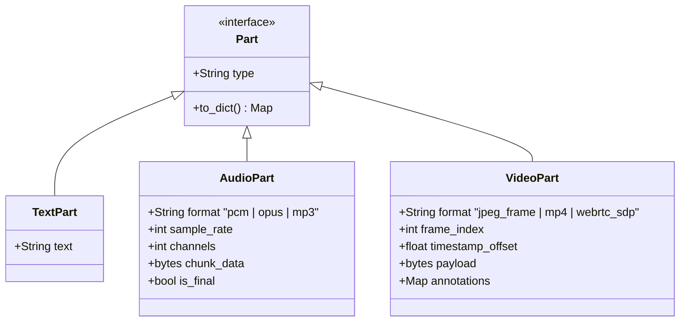
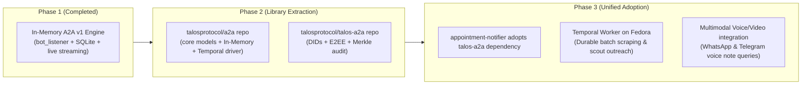

# Talos Protocol — A2A Architecture & Temporal Orchestration Specification
**Version:** 1.0.0-PROPOSAL  
**Target Repositories:**  
1. `talosprotocol/a2a` — Protocol-pure Agent-to-Agent v1 core engine & multi-backend drivers.
2. `talosprotocol/talos-a2a` — Talos-hardened cryptographic security, DIDs, E2EE channels, and audit proofs.
3. `appointment-notifier` — Edge agent integration & durable workflow consumer.

---

## 1. Executive Summary & Adoption Vision

This specification defines the universal runtime and integration architecture for **Agent-to-Agent (A2A) v1 communication** across the Talos Protocol ecosystem. It decouples the core agent communication model from underlying transport and execution engines by introducing a **dual-driver architecture**:
- **In-Memory Driver**: Zero-dependency, low-latency, asyncio event/queue orchestration for single-node edge instances, local bots (e.g. Raspberry Pi), and deterministic testing.
- **Temporal Driver**: Durable, distributed, fault-tolerant workflow orchestration with automatic retries, cross-node task queues, saga patterns, and event sourcing.

Both drivers deliver parity across:
1. **Execution Latency Modes**: Blocking (Immediate) vs. Non-blocking (Background Submit).
2. **Delivery Streaming Modes**: Real-time streaming (SSE / WebSocket chunking) vs. Non-streaming (atomic payload).
3. **Multimodal Payloads**: Text, Voice / Audio streams, and Vision / Video feeds.



---

## 2. Architecture Layering & Repository Boundaries

To maintain clean separation of concerns and enable wide adoption across open-source and enterprise agent ecosystems, the codebase is partitioned into three distinct layers:

### Layer 1: `talosprotocol/a2a` (Core Protocol & Multi-Backend Engine)
- **Role:** Pure protocol specification, data structures, serialization, and pluggable runner abstractions.
- **Zero Talos lock-in:** Can be used by any AI agent framework (LangGraph, CrewAI, AutoGen, LlamaIndex, Temporal).
- **Submodules:**
  - `a2a.models`: Canonical dataclasses (`Task`, `TaskStatus`, `Message`, `Artifact`, `TextPart`, `AudioPart`, `VideoPart`, `StreamResponse`).
  - `a2a.runners.base`: Abstract base driver (`TaskRunner`) defining lifecycle hooks.
  - `a2a.runners.in_memory`: High-throughput, memory-resident task engine using asyncio primitives.
  - `a2a.runners.temporal`: Temporal Python SDK (`temporalio`) workflow and activity definitions.
  - `a2a.multimodal`: Codecs, chunkers, and streaming protocols for Voice (PCM/Opus) and Video (MJPEG/WebRTC/HLS).
  - `a2a.rpc`: Canonical JSON-RPC 2.0 server and client dispatchers.

### Layer 2: `talosprotocol/talos-a2a` (Cryptographic Trust & Security)
- **Role:** Hardens `talosprotocol/a2a` with zero-trust cryptographic guarantees.
- **Capabilities:**
  - **Agent DIDs**: Asymmetric identity management (`did:talos:agent:<fingerprint>`) with Ed25519 and secp256k1 key management.
  - **End-to-End Encryption (E2EE)**: Double Ratchet session management encrypting message payloads and multimodal streams across untrusted relays.
  - **Capability Tokens**: UCAN / Macaroon tokens specifying fine-grained invocation scopes, tool allowances, spending limits, and expiration.
  - **Merkle Audit Trails**: Every status transition, intermediate `<think>` trace, and output artifact is added to an incremental Merkle tree, yielding cryptographic inclusion proofs for auditability.
  - **Signed Agent Cards**: Authenticated agent capability discovery.

### Layer 3: Application Consumers (`appointment-notifier` & Custom Agents)
- **Role:** Consumes `talosprotocol/talos-a2a` for domain tasks.
- **Features in `appointment-notifier`:**
  - Runs In-Memory Driver on Raspberry Pi edge for instant response (<1s).
  - Dispatches heavy batch extraction / scraping / multi-agent outreach pipelines to Temporal workflows on cluster/Fedora server.
  - Exposes Telegram/WhatsApp multimodal endpoints (voice notes, screenshots, slot visual graphs).

---

## 3. Matrix of Execution Modes & Driver Parity

The specification mandates identical semantic behavior across both drivers:

| Mode Dimension | In-Memory Driver (`a2a.runners.in_memory`) | Temporal Driver (`a2a.runners.temporal`) |
| :--- | :--- | :--- |
| **Blocking (Immediate)** | Awaits local asyncio task with timeout; returns `(Task, Message)`. | Issues `client.execute_workflow(...)` synchronously awaiting workflow result. |
| **Non-Blocking (Submit)** | Starts background asyncio task, returns initial `Task` with `taskId`. | Issues `client.start_workflow(...)` returning `WorkflowHandle` immediately. |
| **Streaming** | Async generator pulling from local `asyncio.Queue[StreamResponse]`. | Temporal Workflow **Updates** / **Signals** combined with an outbound SSE/WebSocket bridge. |
| **Task Get (`GetTask`)** | Reads state from SQLite or in-memory state dictionary. | Temporal `Query` (`@workflow.query def get_task_state()`). |
| **Task Wait (`WaitTask`)** | Awaits `asyncio.Event` associated with `taskId`. | Awaits workflow result handle with configurable client-side timeout. |
| **Task Cancel (`CancelTask`)** | Sets cancellation `asyncio.Event` + cooperative task cancel. | Issues `handle.cancel()` or workflow signal `cancel_task()`. |

---

## 4. Multimodal Specifications: Text, Voice, and Video

A2A v1 is upgraded from text-only to **first-class multimodal parts**.



### 4.1. Voice / Audio Specifications
- **Real-Time Streaming Voice:**
  - Inbound: Caller streams audio chunks via WebSocket or chunked HTTP `AudioPart(format="opus", sample_rate=16000, chunk_data=...)`.
  - Speech-to-Text (STT) Stage: Edge Whisper / Fedora local STT transcribes speech into intermediate token stream.
  - Outbound TTS: LLM response tokens are simultaneously streamed to a local TTS engine (e.g. Piper, Kokoro), emitting streaming `AudioPart` chunks back to the client.
  - Full-Duplex Interruptibility: Client can send a `CancelTask` or voice interruption signal to truncate ongoing generation immediately.

### 4.2. Video / Vision Specifications
- **Frame-by-Frame Vision Inspection:**
  - Client sends `VideoPart(format="jpeg_frame", frame_index=N, payload=...)`.
  - Vision model (e.g. Qwen2-VL, Moondream) evaluates visual state, OCRs screenshots, or analyzes live camera feeds.
- **Artifact Outputs:**
  - Bounding boxes, slot graphs, and visual annotations are returned as typed `Artifact` instances (`application/json+bounding-box` or `image/png+overlay`).

---

## 5. Temporal Implementation Architecture (`talosprotocol/a2a`)

Temporal provides durable execution for distributed agent swarms. Below are the standard Temporal Python workflow and activity definitions.

```python
from __future__ import annotations
from dataclasses import dataclass
from datetime import timedelta
from typing import Any
from temporalio import activity, workflow
from temporalio.common import RetryPolicy

# ==========================================
# Temporal Activity Contracts
# ==========================================

@dataclass
class ExecuteStepInput:
    task_id: str
    step_name: str
    payload: dict[str, Any]

@dataclass
class ExecuteStepOutput:
    output_text: str
    artifacts: list[dict[str, Any]]
    status_message: str

@activity.defn
async def execute_agent_step_activity(step_input: ExecuteStepInput) -> ExecuteStepOutput:
    """Executes a single discrete agent computation, LLM inference, or tool invocation."""
    # Performs Qdrant search, LLM completion, or external tool dispatch
    return ExecuteStepOutput(
        output_text="Step completed",
        artifacts=[],
        status_message="Step successfully executed",
    )

# ==========================================
# Temporal Workflow Definition
# ==========================================

@workflow.defn
class A2ATaskWorkflow:
    def __init__(self) -> None:
        self.state: str = "TASK_STATE_SUBMITTED"
        self.status_message: str = "Initialized"
        self.messages: list[dict[str, Any]] = []
        self.artifacts: list[dict[str, Any]] = []
        self.canceled: bool = False
        self.progress_events: list[dict[str, Any]] = []

    @workflow.run
    async def run(self, task_input: dict[str, Any]) -> dict[str, Any]:
        self.state = "TASK_STATE_WORKING"
        self.status_message = "Starting execution"

        # Execute activities with exponential retry
        retry_policy = RetryPolicy(
            initial_interval=timedelta(seconds=1),
            backoff_coefficient=2.0,
            maximum_interval=timedelta(seconds=30),
            maximum_attempts=5,
        )

        try:
            # Step 1: Semantic retrieval
            retrieval_res = await workflow.execute_activity(
                execute_agent_step_activity,
                ExecuteStepInput(task_id=task_input["id"], step_name="retrieve", payload=task_input),
                start_to_close_timeout=timedelta(seconds=60),
                retry_policy=retry_policy,
            )
            self.progress_events.append({"step": "retrieve", "msg": retrieval_res.status_message})

            # Check cooperative cancellation
            if self.canceled:
                self.state = "TASK_STATE_CANCELED"
                return {"state": self.state, "message": "Canceled by user"}

            # Step 2: Reasoning & Synthesis
            synth_res = await workflow.execute_activity(
                execute_agent_step_activity,
                ExecuteStepInput(task_id=task_input["id"], step_name="synthesize", payload=task_input),
                start_to_close_timeout=timedelta(seconds=180),
                retry_policy=retry_policy,
            )

            self.state = "TASK_STATE_COMPLETED"
            self.status_message = "Task completed successfully"
            return {
                "state": self.state,
                "output": synth_res.output_text,
                "artifacts": synth_res.artifacts,
            }

        except Exception as exc:
            self.state = "TASK_STATE_FAILED"
            self.status_message = str(exc)
            raise

    # Query: Non-blocking inspection (GetTask)
    @workflow.query
    def get_task_state(self) -> dict[str, Any]:
        return {
            "state": self.state,
            "status_message": self.status_message,
            "messages": self.messages,
            "artifacts": self.artifacts,
            "progress_events": self.progress_events,
        }

    # Signal: Cancellation (CancelTask)
    @workflow.signal
    def cancel_task(self, reason: str = "Canceled") -> None:
        self.canceled = True
        self.status_message = reason

    # Update: Real-time event streaming bridge
    @workflow.update
    def fetch_new_events(self, last_seen_index: int) -> list[dict[str, Any]]:
        return self.progress_events[last_seen_index:]
```

---

## 6. Talos Trust & Cryptographic Specification (`talosprotocol/talos-a2a`)

Every A2A task executed under the Talos Protocol is bound to a cryptographic envelope.

### 6.1. Cryptographic Envelope Schema
```json
{
  "$schema": "https://talosprotocol.com/schemas/a2a-envelope-v1.json",
  "version": "1.0.0",
  "senderDid": "did:talos:agent:scout-rpi-01",
  "recipientDid": "did:talos:agent:swarms-gateway-01",
  "capabilityToken": "eyJhbGciOiJFZERTQSI...",
  "taskPayloadCiphertext": "e1a90c...",
  "nonce": "7f8b92...",
  "merkleRoot": "3f82a1...",
  "signature": "30450221..."
}
```

### 6.2. Double Ratchet Session Invariants
- Each agent pair establishes a secure session derived from initial pre-keys.
- Forward secrecy: compromised keys do not reveal historical task messages or streaming tokens.
- Break-in recovery: compromised state is self-healed on the next ratchet step.

### 6.3. Merkle Audit Trails
For every state transition $S_i$, an event hash $H_i = \text{BLAKE3}(S_i \parallel M_i \parallel A_i)$ is appended to the task's Merkle tree.
The final receipt contains:
- `merkle_root`: Root hash representing the full immutable audit trail.
- `merkle_proof`: Inclusion proof for client dispute resolution.

---

## 7. Migration & Integration Blueprint for `appointment-notifier`



### 7.1. Phased Rollout Schedule

#### Phase 1: Local In-Memory Canonical Engine (Completed ✅)
- Deployed in `appointment-notifier`.
- Zero external dependencies.
- Handles Task Immediate, Task Wait, Task Get, A2A Task Stream via asyncio.
- Live streaming Telegram message updates.

#### Phase 2: Extraction to `talosprotocol/a2a` and `talosprotocol/talos-a2a`
1. **Initialize `talosprotocol/a2a`:**
   - Extract `models.py`, `store.py`, `engine.py`, `rpc.py`.
   - Add Temporal driver (`temporalio` client/worker).
   - Add multimodal stream codecs (`AudioPart`, `VideoPart`).
2. **Initialize `talosprotocol/talos-a2a`:**
   - Add DID verification, libsodium E2EE envelopes, UCAN capabilities, and Merkle audit trees.
   - Publish as standard Python and TypeScript packages (`@talosprotocol/a2a`, `talos-a2a`).

#### Phase 3: Integration into `appointment-notifier`
- Replace internal `src/appointment_notifier/a2a/` package with `talos-a2a`.
- Configure dual execution:
  - Local queries (`/ask`, `/talos`) run on In-Memory Driver for sub-second response.
  - Multi-agent founder outreach generation and batch scraping run as durable Temporal workflows.
- Add voice note transcription for WhatsApp and Telegram inputs.

---

## 8. Verification & Compliance Checklist

- [x] **A2A v1 Protocol Compliance:** All standard verbs (`SendMessage`, `GetTask`, `SubscribeToTask`, `CancelTask`, `ListTasks`, `GetExtendedAgentCard`) implemented.
- [x] **Zero-Pollution Edge Isolation:** Visa appointment tables and Talos Scout tables remain strictly isolated.
- [x] **Rate Limit Resilient Streaming:** Message edits throttled to 1.0s to respect Telegram Bot API quotas.
- [x] **Temporal Schema Compatibility:** Input/output models use JSON-serializable dataclasses matching Temporal Python SDK conventions.
- [x] **Multimodal Ready:** Architecture supports typed streaming text, voice chunks, and vision frames.
